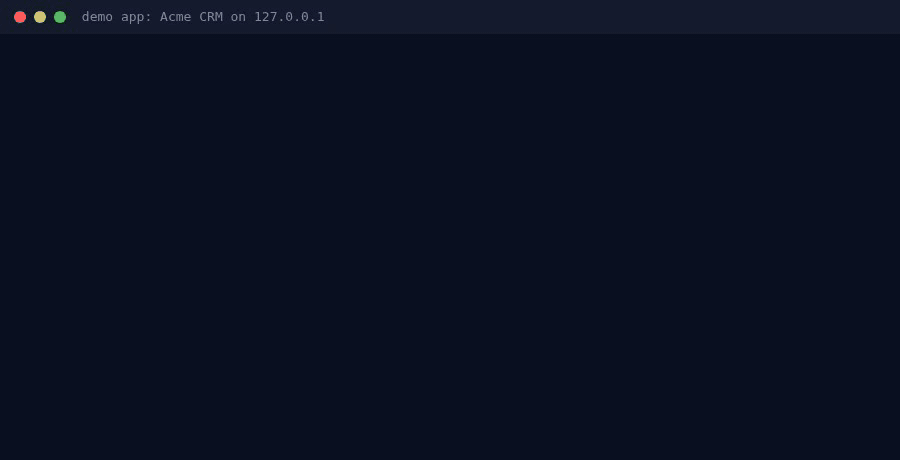
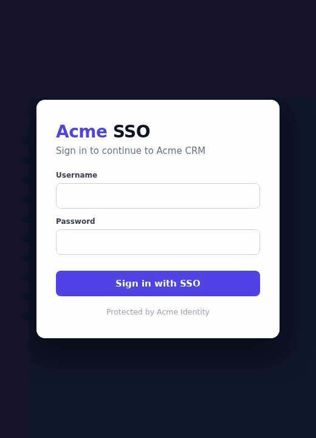
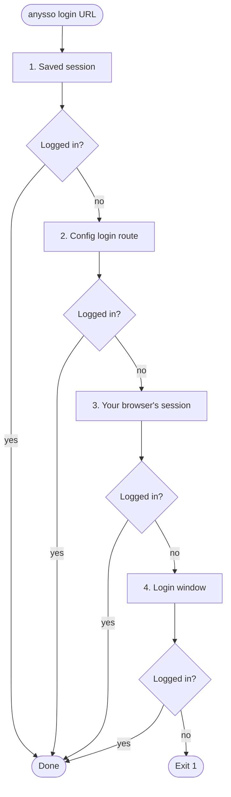

# AnySSO

[](https://github.com/mindtec-victorf/anysso/actions/workflows/ci.yml)
[](LICENSE)


**Log in once to any web system — SSO or not, local or production — and reuse the session from
scripts, tests and AI agents.**



<sub>Demo app: a fictional "Acme CRM" on localhost. The terminal text is the real output of the CLI.</sub>

**Contributors wanted:** see [Help wanted!](#help-wanted).

## Why AnySSO

- **No passwords in scripts.** You sign in where you always do; AnySSO keeps the resulting session.
- **Any identity provider.** SAML, OIDC, Entra ID, Okta, Keycloak, Google, CAS, MFA included: if a
  browser can log in, AnySSO can reuse it.
- **One session, every tool.** Playwright `storageState`, a `Cookie:` header, a curl cookie jar or a
  bearer token.
- **Built for agents.** A bundled Claude Code skill tells the agent when to log in and how to hand
  the session to Playwright or curl.



<sub>Demo app: a staged reproduction of the login window (520x720, the default size).</sub>

## How it works

`anysso login <url>` tries these in order and stops at the first that lands logged in:



1. **Saved session**, validated in a headless browser.
2. **Config login route**, when the site config defines one for the host (see the site config in
   [SKILL.md](skills/login/SKILL.md)).
3. **Your browser's session.** If you are logged in to the site in Firefox (or a fork such as Zen,
   LibreWolf, Waterfox or Floorp), Chrome or Brave, AnySSO reuses that login (where the platform
   allows it: see [Browser session import](#browser-session-import)). It reads only that
   site's cookies (and its identity provider's), and only after you consent once.
4. **Login window.** A small popup where you sign in with your SSO, MFA and all. AnySSO detects when
   you are in and closes it. The window keeps its own profile, so next time the identity provider
   usually logs you in with one click.

The result is a standard [Playwright `storageState`](https://playwright.dev/docs/auth). You can also
export it as a `Cookie:` header, a curl cookie jar or a bearer token.

## Quick start

Requires Node.js >= 22.13 and Playwright.

```bash
npm i -g playwright && npx playwright install chromium
git clone https://github.com/mindtec-victorf/anysso && cd anysso && npm link
anysso doctor
```

```bash
anysso login https://app.example.com/dashboard
curl -H "Cookie: $(anysso export https://app.example.com/api/me)" https://app.example.com/api/me
anysso status
```

**As a Claude Code plugin:**

```
/plugin marketplace add mindtec-victorf/anysso
/plugin install anysso@anysso
```

The agent gets the `anysso:login` skill: when to log in, how to hand the session to Playwright or
curl, and the safety rules.

## Usage

```bash
anysso consent                                  # once: allow reusing your browsers' sessions
anysso login <url>                              # ensure a session; prints the storageState path
anysso login <url> --account alice              # several identities per host
anysso login <url> --no-window                  # CI: fail instead of opening a window
anysso login <url> --window-size 600x800        # login window size (default 520x720)

anysso export <url>                             # Cookie header value
anysso export <url> --format netscape           # cookie jar for curl -b / wget
anysso export <url> --format token              # bearer captured live from the flow (or storage)
anysso export <url> --format json|state         # cookies as JSON | path of the storageState file

anysso login <url> --config sites.json --user alice   # login via a configured route
anysso status                                   # what is saved (never prints secret values)
anysso logout <url> | --all [--forget-window]
anysso login <url> --verify /account            # accept only if that page really shows a logged-in user
anysso config check                             # validate the resolved config file
anysso config add --site '{"match":"*.acme.com"}' [--yes]   # add a site entry (dry run without --yes)
```

```js
// Playwright
const file = execFileSync('anysso', ['login', url]).toString().trim();
const context = await browser.newContext({ storageState: file });
```

```bash
# curl
curl -H "Cookie: $(anysso export https://app.example.com/api/me)" https://app.example.com/api/me
```

Pass the URL of a page that **requires** login. AnySSO decides "logged in" when the page stays on
the target host, off any login route and without a password field. If a site fools that heuristic,
give it a selector that only exists when logged in: `--logged-in '#user-menu'`.

### Site config

For local and private test environments, a JSON file can define a login route, test-user ids and
per-site options. Minimal example (`./.anysso.json`):

```json
{
  "sites": [
    {
      "match": "localhost:8080",
      "login": { "route": "/auth/dev-login?user={user}" },
      "users": { "alice": "1001", "bob": "1002" }
    }
  ]
}
```

`anysso login http://localhost:8080/app --user alice` visits the route and saves the session. The
`--verify <path>` (or the `verify` key) re-checks a new session on a page only a logged user can see, and
`login --json` adds `trail`, `landed` and `hints` so an agent can adapt to portal-based systems;
`anysso config add --site '<json>' --yes` saves the result. The
full format, option precedence and route security rules are in [SKILL.md](skills/login/SKILL.md).

## Supported platforms

Tested on Windows and on Linux under WSL2. Linux and macOS are expected to work for the
saved-session and login-window paths; reports and PRs welcome (see [Help wanted](#help-wanted)).

On WSL, when the Windows host's Edge is reachable, AnySSO opens the login window there; otherwise it
uses a local browser.

### Browser session import

| | Firefox family | Chromium family (Chrome, Brave, Edge, Chromium, Vivaldi) |
|---|---|---|
| Linux | works | works (GNOME keyring or default key) |
| macOS | works | works (Keychain prompt) |
| Windows | works | does not work: app-bound encryption (Chrome 127+) lets only the browser decrypt its cookies |
| WSL | works (Windows and Linux profiles) | does not work for the Windows browsers |

Where import does not work, AnySSO falls through to the login window.

Any environment your machine can reach works: `localhost`, staging, hosts behind a VPN, production.
Local hosts (`localhost`, `*.localhost`, `*.local`, `127.0.0.0/8`, `::1`) accept invalid TLS
certificates automatically; for any other host pass `--insecure` (or set `"insecure": true` in the
site config).

## Security model

- **Your machine, your identity.** AnySSO never sees a password. You type it into the identity
  provider's own page, or it comes from a session you already have.
- **Least data.** It reads only the cookies of the target site and the identity provider it
  redirects to, and saves only those. Each saved file holds one host and one account.
- **Explicit consent** to read browser cookies, stored in `~/.anysso/config.json` and revocable with
  `anysso consent --revoke`.
- **At rest:** sessions live in `~/.anysso/sessions/` as files with mode `0600`, in a directory with
  mode `0700`, the same model as `~/.aws` or Playwright's own auth files. They are live credentials:
  do not commit or share them. Set `ANYSSO_HOME` to move the directory.
- **Untrusted project files.** A `./.anysso.json` that arrives with a cloned repository cannot turn
  off TLS checks or open the login route to public hosts; a login route never leaves the target's
  origin.
- **For agents:** the bundled skill tells the agent to ask before granting consent, to only read on
  production unless asked otherwise, and never to echo secrets.

## Help wanted!

AnySSO is small and the test suite is fast, so a first contribution can land in an evening. These
are the most useful things to pick up (this is the one list; [CONTRIBUTING.md](CONTRIBUTING.md) has
the how-to):

- [ ] Verify the login window natively on **Linux** and **macOS**, and report what you see
- [ ] Cookie import paths for **Safari** and for **Windows Chromium** browsers
- [ ] Identity-provider recipes as example configs: **Okta, Entra ID, Keycloak, Google, Auth0, ADFS, CAS**
- [ ] Port the skill to other agents (Codex, Gemini CLI, Cursor, Copilot agents, ...): the CLI is agent-agnostic; the skill file is Claude Code's format
- [ ] More portal / identity-provider patterns for the adaptation playbook ("Adapting to a new system" in [SKILL.md](skills/login/SKILL.md))
- [ ] Integrations: a **Playwright fixture**, **Cypress / Puppeteer / Selenium** helpers, **k6**,
      **Postman / Bruno**, a **GitHub Actions** example
- [ ] A `docs/recipes/` folder to hold the recipes and integrations above

Browse the [open `help wanted` issues](../../issues?q=is%3Aissue+is%3Aopen+label%3A%22help+wanted%22),
or open one to claim an item.

## Development

```bash
npm test                          # unit + headless end-to-end (fake local app)
ANYSSO_E2E_WINDOW=1 npm test      # also opens a real login window for a few seconds
```

Layout: `skills/login/scripts/anysso.js` (CLI), `lib/pure.js` (decisions, fully unit-tested),
`lib/cookies.js` (browser readers), `lib/browser.js` (headless probe and login window),
`lib/store.js` (state on disk), `lib/config.js` (site config).

## License

MIT
